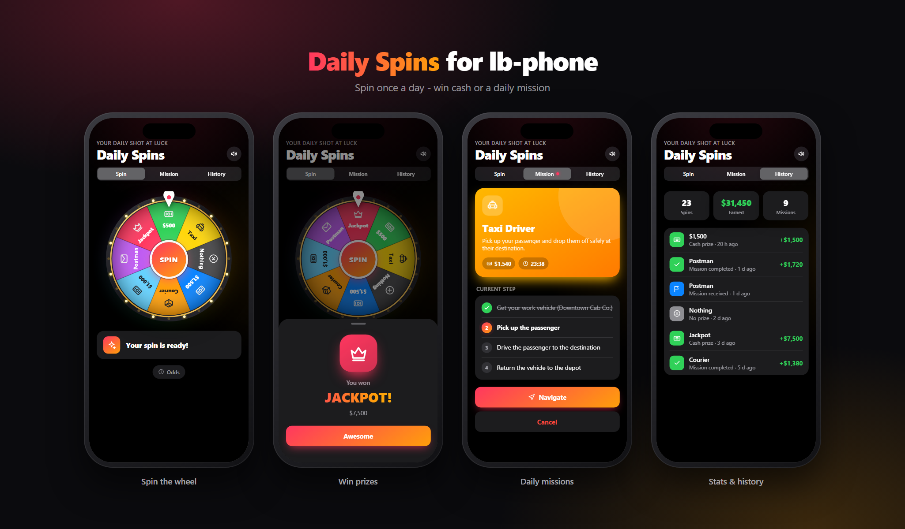
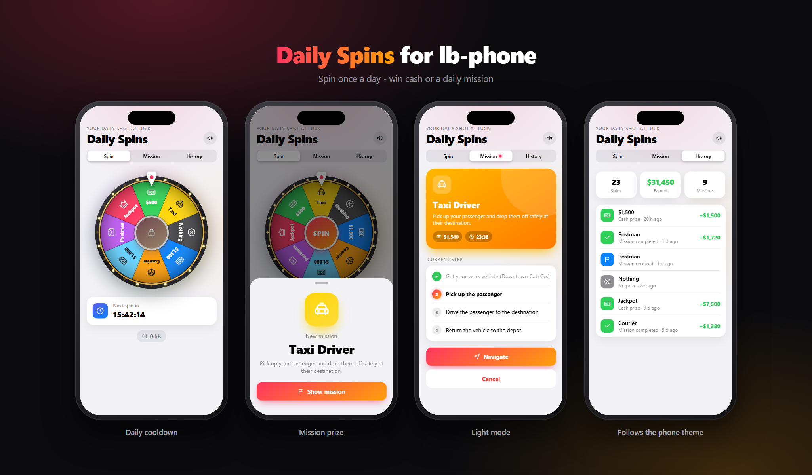

# Daily Spins for lb-phone



**Daily Spins** is a free phone app for FiveM. Players spin a lucky wheel once a day and get one of three things: an instant cash prize, a daily mission (taxi, courier or postman), or nothing at all. It gives people a small reason to log in every day and pulls them out of the same old job loop.

The app runs inside **lb-phone** and inside every phone that implements lb-phone's custom app API (for example sd-phone). It works on **Qbox, QBCore and ESX**, and the framework is detected automatically.

---

## Features

- **A lucky wheel in the phone.** Spin animation with a ticking pointer, blinking rim lights, confetti and synthesized sound effects. No audio files, no external assets.
- **Three kinds of results.**
  - **Cash**: paid out straight away to bank or cash.
  - **Mission**: one of three daily jobs that pays out when it's done.
  - **Nothing**: no luck today, try again after the cooldown.
- **Three missions.**
  - **Taxi Driver**: pick up a passenger and drive them to their destination.
  - **Courier**: pick up a package at a warehouse and deliver it to a customer.
  - **Postman**: deliver mail to three houses, one after another.
- **Configurable cooldown.** Either a rolling 24 hours after the last spin, or a fixed daily reset time. It can be counted per character or per license, so alt characters don't get extra spins.
- **Mission tab** with the reward, a countdown, a step-by-step checklist, a navigation button and a cancel button.
- **History tab** with stats (spins, total earned, missions done) and the last ten results.
- **Odds sheet** that shows players the real chance of every slice. You can turn it off.
- **Follows the phone.** Light and dark mode, and the language is taken from the phone's settings automatically (English and German included).
- **Built to resist abuse.** See [Security](#security).



---

## How it works

1. The player opens **Daily Spins** on their phone and taps **SPIN**.
2. The **server** decides the result with weighted odds. The app only plays the animation for the slice the server chose.
3. If it's cash, the money is paid out right away. If it's a mission, the route is generated on the server and the player gets a phone notification with the first step.
4. A mission always starts at a depot, where the player picks up a work vehicle. After that they follow the waypoint step by step, for example: pick up the passenger → drop them off → return the vehicle.
5. When the last step is done, the reward is paid and the vehicle is removed. If the mission runs out of time, gets cancelled, or the vehicle disappears, it fails and nothing is paid.
6. The next spin unlocks when the cooldown runs out.

---

## Requirements

| Resource | Notes |
|---|---|
| [ox_lib](https://github.com/overextended/ox_lib) | callbacks, notifications, progress bars, text UI, commands |
| [oxmysql](https://github.com/overextended/oxmysql) | database |
| lb-phone *or* a phone with lb-phone app compatibility | e.g. [sd-phone](https://github.com/Samuels-Development/sd-phone) |
| Qbox, QBCore or ESX | detected automatically |
| Optional: `mk_vehiclekeys` / `qbx_vehiclekeys` | keys for the work vehicle |
| Optional: `lc_fuel`, `LegacyFuel`, `cdn-fuel`, `ox_fuel` | full tank for the work vehicle |

---

## Installation

1. Download the latest release, or clone the repository into your resources folder:
   ```
   git clone https://github.com/CASHFL00W/lb-dailyspin.git
   ```
   Keep the folder name `lb-dailyspin` (any name works, the app picks it up automatically).
2. Add it to your `server.cfg` **after** ox_lib, oxmysql, your framework and your phone:
   ```cfg
   ensure ox_lib
   ensure oxmysql
   ensure qbx_core      # or qb-core / es_extended
   ensure lb-phone      # or your phone resource
   ensure lb-dailyspin
   ```
3. Start the server. The database tables `daily_spins` and `daily_spins_log` are created automatically on the first start. You don't need to import any SQL.
4. Open the phone. **Daily Spins** is on the home screen (or in the App Store if you set `defaultApp = false`).
5. Walk to the mission locations in `config.lua` once and adjust them to your map if needed. The included coordinates are suggestions for the default GTA map.

### Admin command

```
/dailyspins_reset [id]
```
Resets the cooldown of a player (or yourself) so they can spin again. It's handy for testing. Restricted to `group.admin` by default (`Config.AdminGroup`).

---

## Configuration

Everything lives in [`config.lua`](config.lua). The most important parts:

| Option | What it does |
|---|---|
| `Config.Locale` | `'auto'` follows the phone language. Use `'en'` / `'de'` to force a language |
| `Config.Cooldown.mode` | `'rolling'` (X hours after the last spin) or `'daily'` (reset at `resetHour`) |
| `Config.Cooldown.perLicense` | `true` = one spin per player across all characters |
| `Config.Wheel.segments` | the slices: type, amount, label, icon, color and **weight** (chance) |
| `Config.Wheel.cashAccount` | `'bank'` or `'cash'` for instant prizes |
| `Config.Missions.*` | reward range, depot, vehicle model, spawn points and locations per mission |
| `Config.Missions.returnVehicle` | the vehicle must be brought back to get paid |
| `Config.Security.*` | anti-exploit limits, optional kick and Discord webhook |

**Odds.** Every slice is drawn the same size, and the chance comes only from `weight`. A slice with weight 2 out of a total of 98 hits about 2% of the time, no matter how it looks on the wheel.

### Adding a language

Copy `locales/en.lua` to, for example, `locales/fr.lua`, rename `Locales.en` to `Locales.fr` and translate the strings. Labels that come from `config.lua` (slice names, mission names, descriptions) can be translated in the `labels` table of the locale file. See `locales/de.lua` for an example. The app switches to the new language automatically when a player's phone is set to it.

---

## Security

The app is only a remote control. Everything that matters is decided and checked on the server:

- **The server rolls the result.** The client never sends a slice, an amount or a reward. It only says "spin", "complete step" or "cancel".
- **Atomic cooldown.** The cooldown is claimed with a single conditional `UPDATE` in the database. Even if a cheater fires the spin event a hundred times in parallel, only one request can pass.
- **Per-player lock and rate limits** on every callback, so double clicks or event spam can't run anything twice.
- **Mission steps are validated server-side.** The server checks:
  - the step index (no skipping or replaying steps),
  - the player's real position on the server against the target,
  - on foot vs. in the vehicle,
  - that the player is in *their own* work vehicle,
  - a minimum time between steps.
- **Teleport detection.** The distance travelled between two steps is compared with the time that passed. Anything faster than `Config.Security.maxSpeed` cancels the mission, gets logged and can optionally kick the player and post to a Discord webhook.
- **The route only exists on the server.** The client only ever learns the current objective.
- **No free vehicles.** Work vehicles are spawned by the server and get removed when the mission ends, fails, expires, or the player disconnects or logs out.
- **The character must be loaded**, so nobody can spin from the character selection screen.

---

## Preview / screenshots

The UI has a demo mode. Open `ui/index.html` directly in a browser and it runs with sample data:

```
ui/index.html?view=spin|mission|history&theme=light|dark&result=jackpot|cash|mission|empty&cooldown=1
```

`docs/showcase.html` arranges several of these views in phone frames. It's what the images in this README were made from.

---

## Credits & license

Made by **CASH**. Released for free under the [MIT License](LICENSE), so you can use it, change it and share it. A credit is appreciated but not required. Please don't resell it.

Issues and pull requests are welcome.
